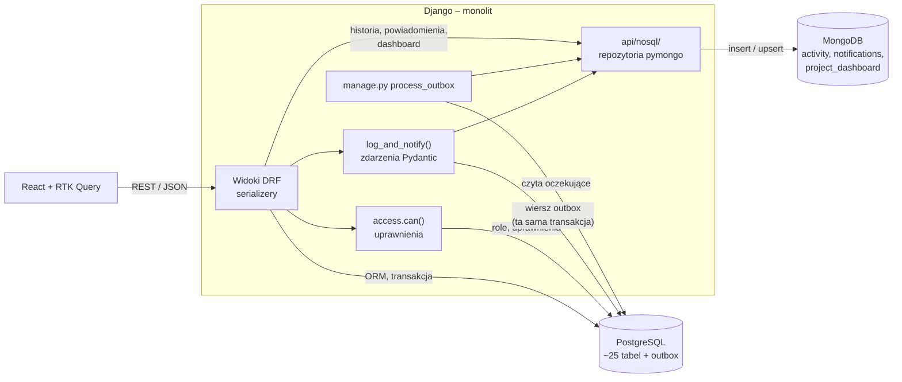
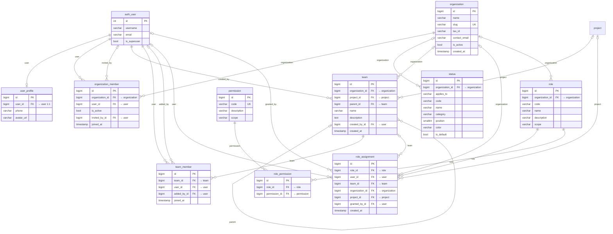
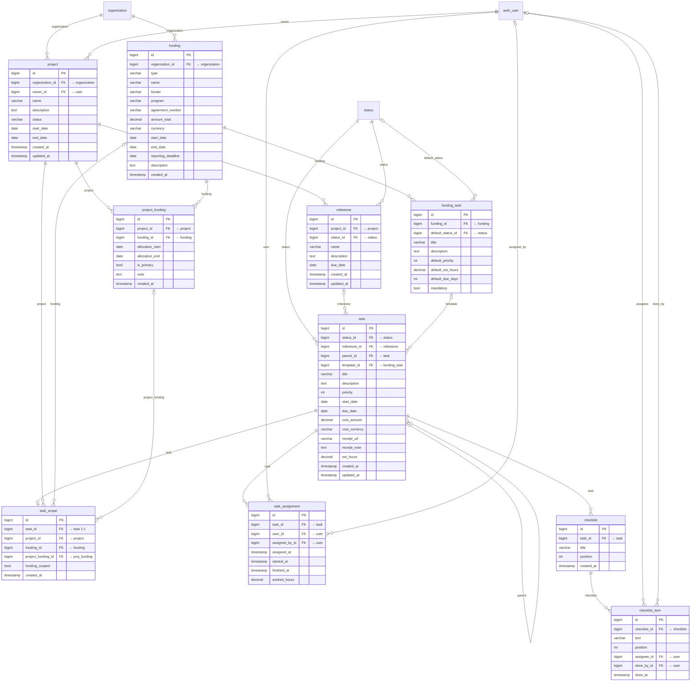
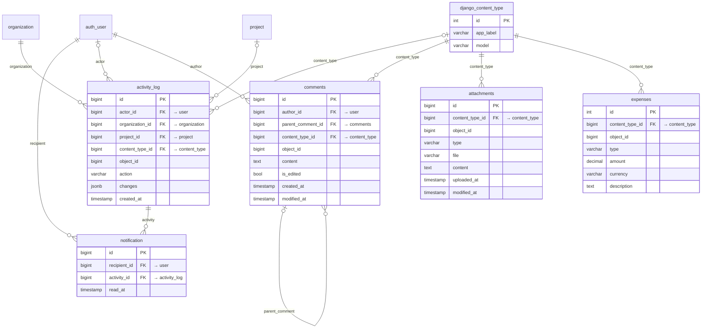
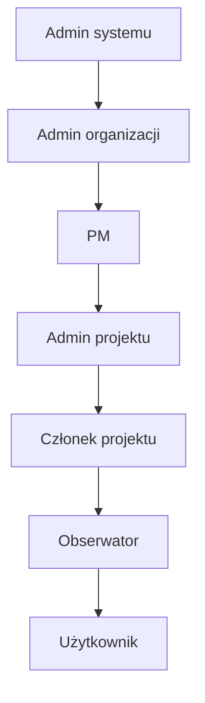
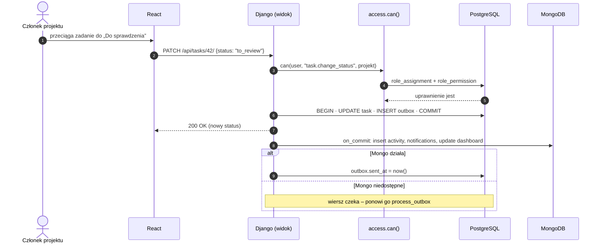

# PROMT – diagramy całej aplikacji (Mermaid)

Wygenerowane z danych strony UML (wersja docelowa). Podgląd w VS Code: `Ctrl+Shift+V`.

## 1. Architektura: monolit + PostgreSQL + MongoDB

## 2. Diagram ER – przegląd wszystkich relacji

```mermaid
erDiagram
    auth_user ||--o| user_profile : "user"
    organization ||--o{ organization_member : "organization"
    auth_user ||--o{ organization_member : "user"
    auth_user |o--o{ organization_member : "invited_by"
    organization |o--o{ status : "organization"
    organization |o--o{ team : "organization"
    project |o--o{ team : "project"
    team |o--o{ team : "parent"
    auth_user ||--o{ team : "created_by"
    team ||--o{ team_member : "team"
    auth_user ||--o{ team_member : "user"
    auth_user |o--o{ team_member : "added_by"
    role ||--o{ role_assignment : "role"
    auth_user |o--o{ role_assignment : "user"
    team |o--o{ role_assignment : "team"
    organization |o--o{ role_assignment : "organization"
    project |o--o{ role_assignment : "project"
    auth_user |o--o{ role_assignment : "granted_by"
    organization |o--o{ role : "organization"
    role ||--o{ role_permission : "role"
    permission ||--o{ role_permission : "permission"
    organization ||--o{ project : "organization"
    auth_user ||--o{ project : "owner"
    organization ||--o{ funding : "organization"
    project ||--o{ project_funding : "project"
    funding ||--o{ project_funding : "funding"
    funding ||--o{ funding_task : "funding"
    status |o--o{ funding_task : "default_status"
    status ||--o{ task : "status"
    milestone |o--o{ task : "milestone"
    task |o--o{ task : "parent"
    funding_task |o--o{ task : "template"
    task ||--o| task_scope : "task"
    project ||--o{ task_scope : "project"
    funding |o--o{ task_scope : "funding"
    project_funding |o--o{ task_scope : "project_funding"
    task ||--o{ task_assignment : "task"
    auth_user ||--o{ task_assignment : "user"
    auth_user |o--o{ task_assignment : "assigned_by"
    project ||--o{ milestone : "project"
    status ||--o{ milestone : "status"
    task ||--o{ checklist : "task"
    checklist ||--o{ checklist_item : "checklist"
    auth_user |o--o{ checklist_item : "assignee"
    auth_user |o--o{ checklist_item : "done_by"
    auth_user ||--o{ notification : "recipient"
    activity_log ||--o{ notification : "activity"
    auth_user |o--o{ activity_log : "actor"
    organization ||--o{ activity_log : "organization"
    project |o--o{ activity_log : "project"
    django_content_type |o--o{ activity_log : "content_type"
    auth_user ||--o{ comments : "author"
    comments |o--o{ comments : "parent_comment"
    django_content_type ||--o{ comments : "content_type"
    django_content_type ||--o{ attachments : "content_type"
    django_content_type ||--o{ expenses : "content_type"
```

## 3. Diagram ER – Dostęp i organizacja

## 4. Diagram ER – Projekty, finansowanie i zadania

## 5. Diagram ER – Historia, powiadomienia i relacje generyczne

## 6. Role (każda wyższa ma wszystko z niższej)

## 7. Przypadki użycia – co dochodzi na każdym poziomie

```mermaid
flowchart LR
    subgraph R0["Użytkownik"]
        direction TB
        R0_0(["Zaloguj się"])
        R0_1(["Edytuj swój profil"])
        R0_2(["Zmień hasło"])
        R0_3(["Przeglądaj powiadomienia"])
        R0_4(["Oznacz jako przeczytane"])
        R0_5(["Ustaw preferencje powiadomień"])
        R0_6(["Przełącz organizację"])
    end
    subgraph R1["Obserwator"]
        direction TB
        R1_0(["Przeglądaj projekty"])
        R1_1(["Przeglądaj szczegóły projektu"])
        R1_2(["Śledź postęp etapów"])
        R1_3(["Przeglądaj i filtruj zadania"])
        R1_4(["Przeglądaj tablicę Kanban"])
        R1_5(["Przeglądaj checklisty"])
        R1_6(["Czytaj komentarze i pliki"])
        R1_7(["Przeglądaj finansowania"])
        R1_8(["Przeglądaj zespół projektu"])
    end
    subgraph R2["Członek projektu"]
        direction TB
        R2_0(["Utwórz zadanie"])
        R2_1(["Edytuj swoje zadanie"])
        R2_2(["Zmień status swojego zadania"])
        R2_3(["Zgłoś zadanie do sprawdzenia"])
        R2_4(["Dodaj podzadanie"])
        R2_5(["Rejestruj czas pracy"])
        R2_6(["Odhacz swój punkt"])
        R2_7(["Komentuj"])
        R2_8(["Wspomnij @osobę"])
        R2_9(["Dodaj załącznik"])
    end
    subgraph R3["Admin projektu"]
        direction TB
        R3_0(["Edytuj projekt"])
        R3_1(["Zamknij lub usuń projekt"])
        R3_2(["Zarządzaj etapami"])
        R3_3(["Edytuj dowolne zadanie"])
        R3_4(["Przypisz osoby do zadania"])
        R3_5(["Zaakceptuj lub odrzuć zadanie"])
        R3_6(["Usuń zadanie"])
        R3_7(["Twórz i edytuj checklisty"])
        R3_8(["Przypisz osobę do punktu"])
        R3_9(["Moderuj komentarze"])
        R3_10(["Zarządzaj członkami projektu"])
        R3_11(["Zarządzaj grupami projektu"])
        R3_12(["Przeglądaj log projektu"])
    end
    subgraph R4["PM"]
        direction TB
        R4_0(["Utwórz projekt"])
        R4_1(["Dodaj i edytuj finansowanie"])
        R4_2(["Zarządzaj szablonami zadań"])
        R4_3(["Podepnij finansowanie do projektu"])
        R4_4(["Rejestruj wydatki"])
        R4_5(["Raport budżetu"])
        R4_6(["Dodaj pracownika do organizacji"])
        R4_7(["Nadaj niższą rolę"])
        R4_8(["Zarządzaj grupami organizacji"])
    end
    subgraph R5["Admin organizacji"]
        direction TB
        R5_0(["Nadaj dowolną rolę"])
        R5_1(["Zablokuj członka"])
        R5_2(["Twórz własne role"])
        R5_3(["Przeglądaj log organizacji"])
        R5_4(["Edytuj ustawienia organizacji"])
        R5_5(["Zarządzaj statusami"])
    end
    subgraph R6["Admin systemu"]
        direction TB
        R6_0(["Załóż organizację"])
        R6_1(["Zablokuj organizację"])
        R6_2(["Panel administracyjny"])
    end
    R1 -- "dziedziczy" --> R0
    R2 -- "dziedziczy" --> R1
    R3 -- "dziedziczy" --> R2
    R4 -- "dziedziczy" --> R3
    R5 -- "dziedziczy" --> R4
    R6 -- "dziedziczy" --> R5
```

## 8. Sekwencja: zmiana statusu zadania (Postgres + outbox + Mongo)

## 9. Statusy zadań

Osobny plik: [statusy.md](statusy.md).
