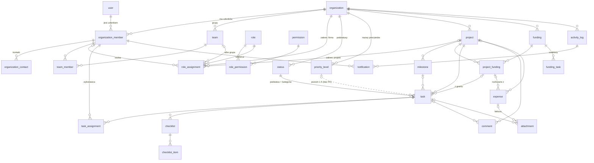
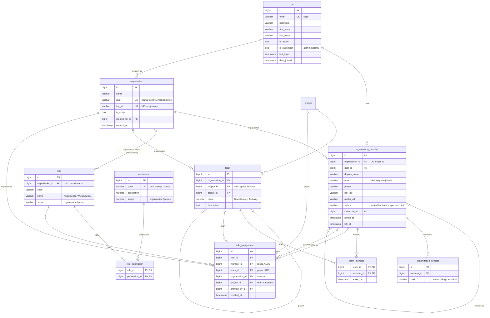
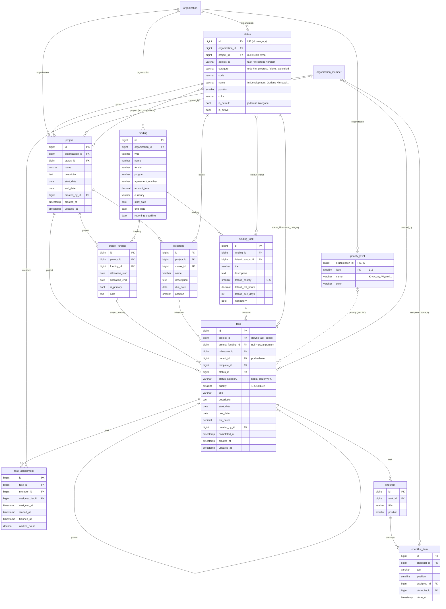
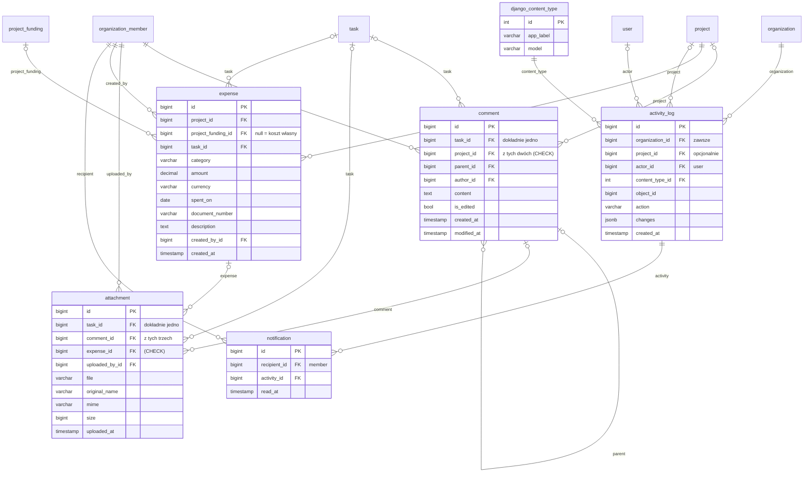

# PROMT – schemat bazy v2 (propozycja)

26 własnych tabel + `django_content_type`. Podgląd w VS Code: `Ctrl+Shift+V`.

## Co się zmienia względem wersji 25 tabel

| Zmiana | Dlaczego |
|---|---|
| `auth_user` + `user_profile` → jeden `user` (własny model, tylko dane globalne: login, hasło, imię, nazwisko) | dane „w firmie” są różne w każdej organizacji |
| `organization_member` dostaje dane osoby w danej firmie: e-mail służbowy, telefon, stanowisko, nazwa wyświetlana, status | ta sama osoba w dwóch firmach = dwa różne „profile” |
| przypisania, zespoły, role, checklisty, powiadomienia wskazują na **`organization_member`**, nie na `user` | osoba działa zawsze w kontekście firmy |
| `organization.contact_email` → tabela **`organization_contact`** (osoba + rodzaj: główny / rozliczenia / techniczny) | kontaktem jest konkretna osoba z firmy, nie luźny adres |
| `status` = **podstatus**, pole `category` = status główny: `todo / in_progress / done / cancelled` | firmy i projekty dodają własne podstatusy, logika systemu opiera się na 4 kategoriach |
| statusy są per organizacja (kopiowane przy zakładaniu firmy), opcjonalnie per projekt | każda firma może zmienić nazwy, projekt może dodać swoje |
| `task.status_category` – kopia kategorii pilnowana **złożonym FK** | filtrowanie po kategorii bez JOIN-a, baza sama pilnuje zgodności |
| `priority` = liczba 1–5 (CHECK), nazwy w **`priority_level`** (opcjonalnie per firma) | sortowanie/filtr bez JOIN-a, a firma może nazwać poziomy po swojemu |
| `task_scope` (1:1) wchłonięte do `task` (`project_id`, `project_funding_id`) | jeden JOIN mniej w każdym zapytaniu o zadania |
| koszty z `task` → `expense` (twarde FK) | wydatek to osobny fakt, zadanie może mieć ich kilka |
| `comment` / `attachment` z osobnymi kolumnami FK + CHECK „dokładnie jedno” zamiast relacji generycznej | prawdziwe klucze obce i indeksy |

## 1. Przegląd – wszystkie połączenia



## 2. Tożsamość, organizacja i uprawnienia



## 3. Statusy, priorytety, projekty i zadania



## 4. Współpraca, koszty i historia



## 5. Optymalizacja – jak wyglądają typowe zapytania

Złożony FK pilnuje, że kopia kategorii w zadaniu zawsze zgadza się ze statusem
(Django nie ma złożonych FK – dodajemy je w migracji przez `RunSQL`):

```sql
ALTER TABLE status ADD CONSTRAINT status_id_category_uq UNIQUE (id, category);
ALTER TABLE task ADD CONSTRAINT task_status_fk
    FOREIGN KEY (status_id, status_category) REFERENCES status (id, category)
    ON UPDATE CASCADE;   -- zmiana kategorii podstatusu sama poprawi zadania
ALTER TABLE task ADD CONSTRAINT task_priority_ck CHECK (priority BETWEEN 1 AND 5);
```

„Moje otwarte zadania w firmie, od najważniejszych” – **jeden JOIN**, bez statusów i priorytetów:

```sql
SELECT t.id, t.title, t.priority, t.due_date
FROM task t
JOIN task_assignment a ON a.task_id = t.id
WHERE a.member_id = :member
  AND t.status_category IN ('todo', 'in_progress')
ORDER BY t.priority DESC, t.due_date;
```

Indeksy:

```sql
CREATE INDEX task_board_ix   ON task (project_id, status_category, priority DESC, due_date);
CREATE INDEX task_overdue_ix ON task (due_date) WHERE status_category IN ('todo', 'in_progress');
CREATE INDEX assignment_ix   ON task_assignment (member_id, task_id);
```

Kanban projektu dołącza `status` tylko po nazwę i kolor podstatusu – to tabela
z kilkunastoma wierszami, którą frontend i tak trzyma w cache.
