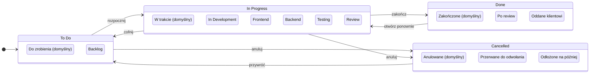

# Statusy zadań – v2

Status główny = pole `category` (stała lista, na niej opiera się logika systemu):
**todo**, **in_progress**, **done**, **cancelled**.

Podstatus = wiersz w tabeli `status`. Wbudowane są kopiowane do każdej nowej organizacji;
firma może je zmieniać i dodawać własne, projekt może dodać swoje.
Przykłady poniżej – kursywą te, które firma/projekt dodaje sama.

## Zasady

- Kategorie są 4 i są stałe (choices w kodzie), bo od nich zależą: postęp %, „zaległe”, KPI, raporty.
- Swoboda firm jest w podstatusach – dowolna liczba w każdej kategorii.
- `is_default` – jeden na (organizacja, projekt, applies_to, category); np. „rozpocznij” ustawia domyślny podstatus In Progress.
- Zadanie trzyma `status_id` i kopię `status_category` (złożony FK) – szczegóły w [schemat-v2.md](schemat-v2.md).
- Kanban: 4 kolumny (albo 3 + ukryte anulowane), w kolumnie sekcje według podstatusów.
